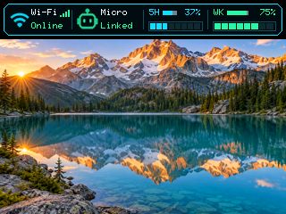
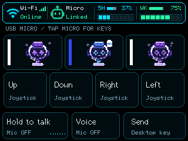

# Optional monitor photos — 2026-10-11

Firmware 0.8.0 implements idle photos with a live usage bar, browser image
preparation/upload, normal/blank/photo idle choices and timing combined with
screen-off. It uses a 320 × 196 RGB565 PSRAM cache and the existing SD_MMC
wiring. The feature defaults to the normal monitor UI.

## Software checks

- PlatformIO `codex-monitor`: pass, 3,389,557 flash bytes in the existing 4 MiB
  OTA slot, 154,348 static RAM bytes. Final upload verified hashes.
- PlatformIO `codex-audio-diag`: pass; it shares monitor SDK defaults.
- Native tests: 36 pass, including idle delay/screen-off precedence, busy and
  asleep behavior, settings validation, paths, frame headers and CRC32.
- Browser tests: 19 pass, including RGB565 channels/alpha/CRC, acknowledged
  complete uploads, chunk failure cancellation and idle-delay validation.
- Site build and two site tests pass. Chromium smoke checks pass at 1440,
  768 and 390-pixel widths with the added idle controls and photo panel.
- Firmware-CI host tests: 13 pass.

The first SD check mounted the card but could not create the photo directory
(`errno=22`): the monitor config had `CONFIG_FATFS_LFN_NONE=y`. Heap-based long
filenames with a bounded 64-character maximum fixed directory creation and
writes. No formatting or erase-all was performed. Switching from standalone
photo-frame firmware restored the documented monitor partitions and speech
models. `/photos` remains separate from the new `/monitor-photos` directory.

## Physical transfer and display

PlatformIO serial monitoring ran at 115200 through a localhost bridge to
Windows COM9, retaining USB Micro/Desktop and audio access. Serial packets use
the same bounded mailbox, file processor, offsets, CRC and commit path as BLE;
this does not test BLE transport.

- An incomplete upload was rejected with `checksum_or_size_failed` and no
  completed file appeared.
- Two 125,456-byte frames committed: `01-alpine-lake.fpf` and
  `02-red-poppy.fpf`. Acknowledged offsets reached 125456. Serial transfers
  took 101.9 and 105.6 seconds; these are **not BLE timings**.
- Hex commands can overrun Arduino CDC's 256-byte receive queue. Successful
  diagnostic chunks used 100 file bytes. Binary BLE chunks remain 180 bytes,
  separately exercised in the browser harness.
- Actual LCD readback shows the lake below the live usage bar. Logs confirm
  cycling to the poppy and back to the lake.
- Internal free heap was 36,959 bytes with a displayed photo, the same as after
  mounting. PSRAM went from 8,276,320 to 8,149,340 bytes with the cache allocated.
  SD uploads temporarily reported 36,703 internal heap bytes.
- The Windows USB audio endpoint returned 160,000 bytes at 16 kHz mono during
  upload with the outgoing microphone muted. The board reported `usb_dropped=0`.
  This verifies stream availability, not spoken audio quality.
- Preview leaves saved mode 0 unchanged. `photo-off` restores normal controls
  and releases the frame cache.

See [transfer milestones](monitor-photos-2026-10-11/transfer.log). The
[diagnostic helper](../../scripts/check_monitor_photos.py) supports
`--transfer-only`, then `--skip-upload`, with an output directory and Pillow.

## Remaining checks

Physical BLE settings saving, complete BLE uploads, throughput, cancellation on
real BLE disconnect, real touch wake and automatic idle-to-screen-off acceptance
remain **UNKNOWN**. Windows WinRT discovery timed out or failed event
subscription. Automated tests do not establish these actions. Rendering used
USB Micro mode with recognition paused; SD/photos alongside active Wi-Fi speech
recognition and its lower internal-heap profile remain **UNKNOWN**. Power loss
during replacement was not injected. Keep this optional feature off by default.

## Final firmware readback

After the wake fix was flashed, the saved two files were still present. The
read-only check completed successfully. Free heap stayed at 36,919 bytes;
PSRAM was 8,149,348 bytes with a frame and returned to 8,276,324 bytes after
`photo-off`. Status and voice workers remained present, Wi-Fi stayed connected,
and USB audio drops stayed zero. The board was left on its normal UI with
saved idle mode 0. [Final serial milestones](monitor-photos-2026-10-11/serial.log)
omit the screenshot hex rows; PNGs retain the actual LCD readback.

